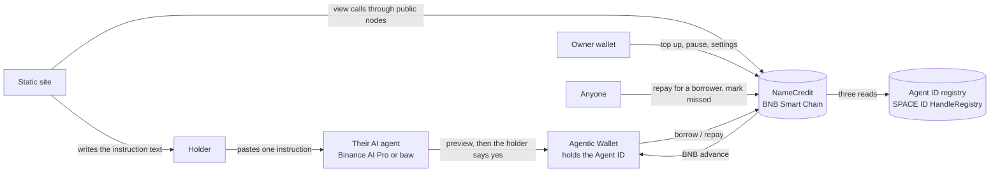
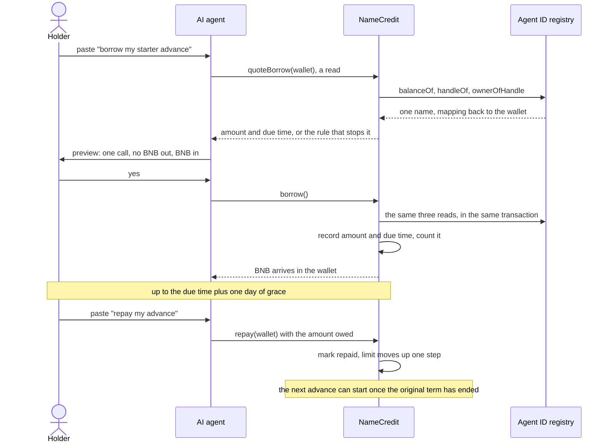
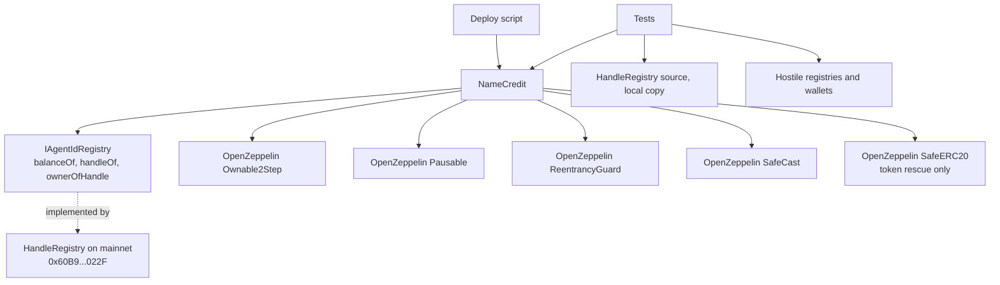

# Architecture

One contract, a static site and an instruction file for agents. No server, no database, no token.

## System overview

## Main sequence: one advance, start to finish

## Contract and module dependencies

## Deployed addresses

| Network | Contract | Address |
|---|---|---|
| BNB Smart Chain mainnet | Agent ID registry (not ours) | `0x60B9262456dE011F7d15a54CdD8c48bAaa8B022F` |
| BNB Smart Chain mainnet | NameCredit | not deployed yet |
| BNB Smart Chain testnet | NameCredit and a stand-in registry | not deployed yet |

## The interface the site and the agent skill use

Reads, all view calls on `NameCredit`:

| Call | Returns | Used for |
|---|---|---|
| `standingOf(address)` | step, limit, owed, due, overdueAt, missed, notBefore, onTime, late, nameHash | A visitor's own record |
| `quoteBorrow(address)` | refusal code, amount, due | The borrow instruction, and the plain reason when it would fail |
| `pool()` | balance, outstanding, slotsNow, nextSlotAt, newAdvancesPaused | "Available now" on the first screen |
| `totals()` | people, lent, repaid, outstanding, toppedUp, withdrawn | Headline numbers |
| `stepTally(uint8)` | advances, onTime, late, missed, lent, repaid | The proof number and the ladder table |
| `dayTally(uint32)` | advances, onTime, late, missed | Repayment by the day the advance was made |
| `borrowerCount()`, `borrowersPage(start, count)` | wallets in order of first advance | The daily sweep that marks overdue advances |
| `settings()`, `pendingSettings()`, `pendingSettingsAt()` | the four settings and any scheduled change | The rules shown on the docs page |
| `holdsAgentId(address)` | true or false | "You need an Agent ID" before any instruction is shown |

Refusal codes from `quoteBorrow`: 0 none, 1 paused, 2 an advance is open, 3 too early, 4 no Agent ID, 5 pace exhausted, 6 pool empty.

Writes a holder's agent makes:

| Call | BNB attached | Calldata |
|---|---|---|
| `borrow()` | 0 | `0xe68d3569`, the same four bytes for everyone |
| `borrowWithPass(bytes32 code)` | 0 | `0x5735ce7b` plus the 32 byte code |
| `repay(address borrower)` | exactly `standingOf(borrower).owed` | `0x9f7c73e9` plus the borrower address |

The site and the skill take these from the compiled ABI at build time. They are listed here so that anyone can check an instruction by eye.

Writes anyone may make: `repay(address)`, `markMissed(address)`, `markMissedMany(address[])`, `applySettings()`.

Writes only the owner may make: `topUp()`, `withdraw(uint256)`, `pause()`, `unpause()`, `scheduleSettings(Settings)`, `cancelSettings()`, `addPasses(bytes32[], uint40)`, `revokePass(bytes32)`, `rescueToken(address, uint256)`, `transferOwnership(address)` then `acceptOwnership()` by the new owner.

## Gas, measured in the test suite at 0.05 gwei and BNB at 559.51 dollars

| Action | Gas | BNB | Dollars |
|---|---|---|---|
| First advance, typical | 162,673 | 0.0000081 | 0.005 |
| First advance, worst case seen | 284,353 | 0.0000142 | 0.008 |
| Repay, typical | 61,775 | 0.0000031 | 0.002 |
| Mark missed | 24,554 | 0.0000012 | 0.001 |
| Deploy (estimate from a dry run on a mainnet fork) | 4,354,138 | 0.00022 | 0.12 |
