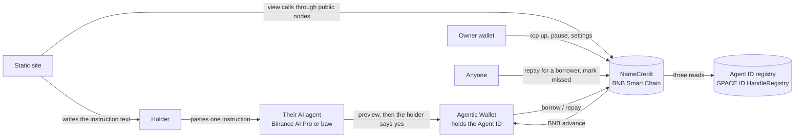
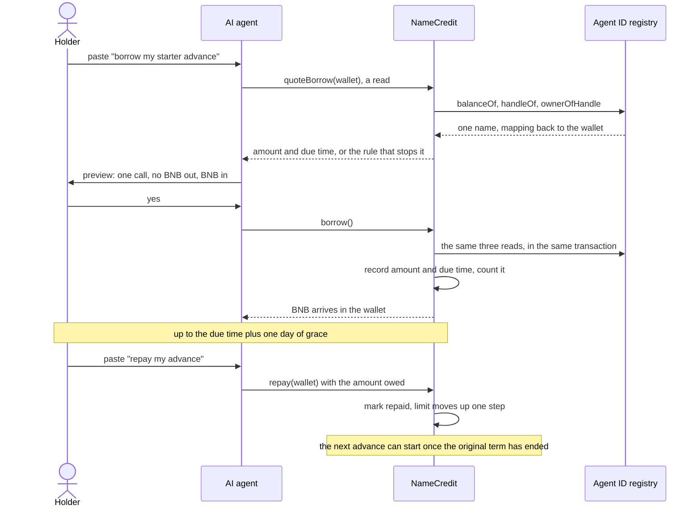
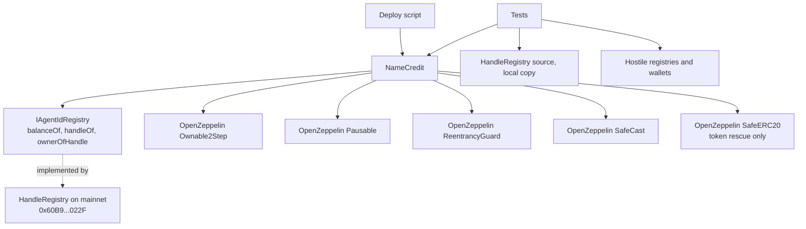

# Architecture

One contract, a static site and an instruction file for agents. No server, no database, no token.

## System overview

## Main sequence: one advance, start to finish

## Contract and module dependencies

## Deployed addresses

| Network | Contract | Address |
|---|---|---|
| BNB Smart Chain mainnet | Agent ID registry (not ours) | `0x60B9262456dE011F7d15a54CdD8c48bAaa8B022F` |
| BNB Smart Chain mainnet | NameCredit | [`0xc0337932e0Cd049aFa990A9A470c059586B2d9AE`](https://bscscan.com/address/0xc0337932e0Cd049aFa990A9A470c059586B2d9AE), [verified source](https://repo.sourcify.dev/56/0xc0337932e0Cd049aFa990A9A470c059586B2d9AE). Owner `0x96E854aBDdc5C618ca843956d1303017b586aB75`. Deployed 24 November 2026 in block 135,449,026 |
| BNB Smart Chain testnet | NameCredit | [`0x31bed8A1f6C762ADF1F7208aFEaee828B1bF7726`](https://testnet.bscscan.com/address/0x31bed8A1f6C762ADF1F7208aFEaee828B1bF7726), [verified source](https://repo.sourcify.dev/97/0x31bed8A1f6C762ADF1F7208aFEaee828B1bF7726) |
| BNB Smart Chain testnet | Stand-in Agent ID registry | [`0x0921b8D3d052515612DAc3F0013F9bb51a86B0c6`](https://testnet.bscscan.com/address/0x0921b8D3d052515612DAc3F0013F9bb51a86B0c6), [verified source](https://repo.sourcify.dev/97/0x0921b8D3d052515612DAc3F0013F9bb51a86B0c6) |
| BNB Smart Chain testnet | Attack runner | [`0x21F2277F1b0aA3430dBD7f5e1236d9F2529fBD14`](https://testnet.bscscan.com/address/0x21F2277F1b0aA3430dBD7f5e1236d9F2529fBD14), [verified source](https://repo.sourcify.dev/97/0x21F2277F1b0aA3430dBD7f5e1236d9F2529fBD14) |

The mainnet code is byte for byte the code of the testnet pool below, apart from the registry address it reads; the record is `security/outputs/mainnet-2026-11-24.txt`.

Agent ID exists on mainnet only. The testnet registry is a stand-in deployed from the real registry's verified source, with the same name lengths (3 to 20) and owned by a testnet-only wallet so that test names can be issued. The testnet pool runs with a 1 hour term and a pace of 24 a day, so that the attack scripts can exhaust the pace and reach a late payment in a day; the mainnet pool is planned with a 3 day term and a pace of 100 a day. The record of the testnet run is in `security/outputs/`.

To check a deployment yourself, run `forge script script/Check.s.sol --rpc-url <a public node>` from `packages/contracts`. It sends nothing and needs no key. It reads the address from `deployments/<chain id>.json` and the facts from the chain: the registry the pool reads, its owner, its four settings, whether it is paused and whether a change is scheduled. On mainnet it fails unless the pool reads the real Agent ID registry, and it says whether the settings are still the ones in `script/Plan.sol`.

## The interface the site and the agent skill use

Reads, all view calls on `NameCredit`:

| Call | Returns | Used for |
|---|---|---|
| `standingOf(address)` | step, limit, owed, due, overdueAt, missed, notBefore, onTime, late, nameHash | A visitor's own record |
| `quoteBorrow(address)` | refusal code, amount, due | The borrow instruction, and the plain reason when it would fail |
| `pool()` | balance, outstanding, slotsNow, nextSlotAt, newAdvancesPaused | "Available now" on the first screen |
| `totals()` | people, lent, repaid, outstanding, toppedUp, withdrawn | Headline numbers |
| `stepTally(uint8)` | advances, onTime, late, missed, lent, repaid | The proof number and the ladder table |
| `dayTally(uint32)` | advances, onTime, late, missed | Repayment by the day the advance was made |
| `borrowerCount()`, `borrowersPage(start, count)` | wallets in order of first advance | The daily sweep that marks overdue advances |
| `settings()`, `pendingSettings()`, `pendingSettingsAt()`, `SETTINGS_WINDOW()` | the four settings and any scheduled change | The rules shown on the docs page. A scheduled change can be applied from `pendingSettingsAt` until `SETTINGS_WINDOW` (7 days) later. After that it has lapsed: it still reads as pending until the owner cancels or replaces it, but it can never arrive, and the site must say so |
| `holdsAgentId(address)` | true or false | "You need an Agent ID" before any instruction is shown |

Refusal codes from `quoteBorrow`: 0 none, 1 paused, 2 an advance is open, 3 too early, 4 no Agent ID, 5 pace exhausted, 6 pool empty.

Writes a holder's agent makes:

| Call | BNB attached | Calldata |
|---|---|---|
| `borrow()` | 0 | `0xe68d3569`, the same four bytes for everyone |
| `borrowWithPass(bytes32 code)` | 0 | `0x5735ce7b` plus the 32 byte code. First advance only: above the first step it is refused with `PassNotNeeded` and the plain `borrow()` is the call to make |
| `repay(address borrower)` | exactly `standingOf(borrower).owed` | `0x9f7c73e9` plus the borrower address |

The site and the skill take these from the compiled ABI at build time. They are listed here so that anyone can check an instruction by eye.

Writes anyone may make: `repay(address)`, `markMissed(address)`, `markMissedMany(address[])`, and `applySettings()`, which works from 12 hours after a change is scheduled until 7 days after that.

Writes only the owner may make: `topUp()`, `withdraw(uint256)`, `pause()`, `unpause()`, `scheduleSettings(Settings)`, `cancelSettings()`, `addPasses(bytes32[], uint40)`, `revokePass(bytes32)`, `rescueToken(address, uint256)`, `transferOwnership(address)` then `acceptOwnership()` by the new owner.

## Gas

On mainnet, from the first real borrow and repay on 25 November 2026, sent by Binance AI Pro from an Agentic Wallet (`security/outputs/mainnet-first-use-2026-11-25.txt`). The fee is what those transactions actually paid; the dollar column prices it at 539.65 dollars per BNB, the price AI Pro showed that day.

| Action on mainnet | Gas used | Fee paid in BNB | Dollars |
|---|---|---|---|
| First advance (plain borrow, first time this wallet borrows) | 262,573 | 0.0000250 | 0.013 |
| Repay | 58,956 | 0.0000070 | 0.004 |

These are the figures a holder pays. The testnet first advance below took a different path (a borrow with a pass, sent from a small wallet contract, against a stand-in registry), so the two are not comparable.

On testnet, from real transactions on 24 November 2026 (hashes in `security/outputs/`), priced at what mainnet charged on 23 November: 0.05 gwei, with BNB at 559.51 dollars.

| Action on testnet | Gas used | BNB | Dollars |
|---|---|---|---|
| First advance (with a pass, sent through a small wallet contract) | 160,282 | 0.0000080 | 0.0045 |
| Repay | 58,944 | 0.0000029 | 0.0016 |
| Deploy | 3,376,974 | 0.00017 | 0.094 |
| Mark missed | about 45,000 | 0.0000023 | 0.0013 |

The mark missed figure is not from a live transaction: it is the 24,000 gas the test suite measures for the call plus the 21,000 every transaction pays. A first advance costs more when the storage it touches has never been written, which is the usual case and the one measured here.
