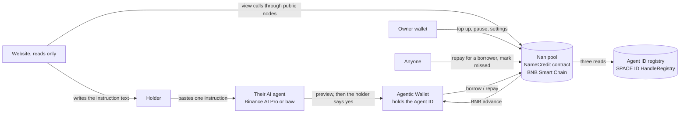
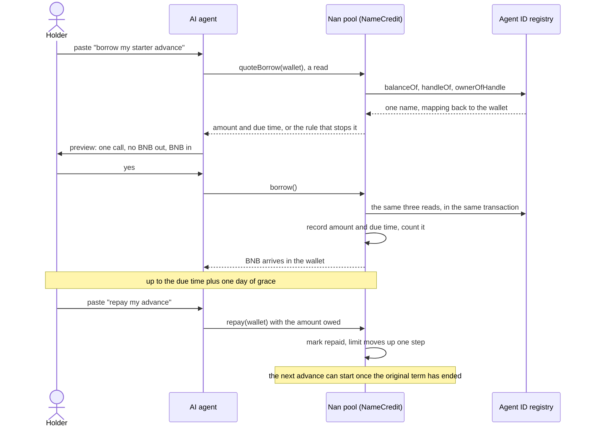
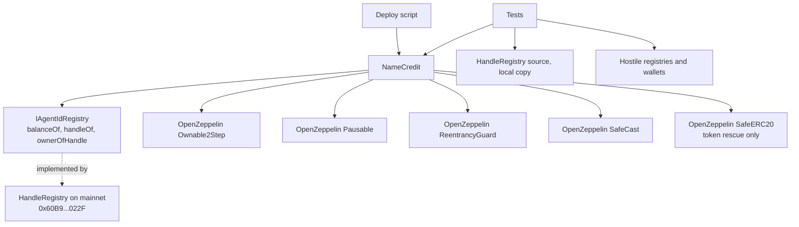

# Nan

Small BNB advances for any wallet that holds an Agent ID. Nothing locked up. Repay on time and the limit doubles.

[Live app](https://nan-agent.vercel.app) • [Docs](https://nan-agent.vercel.app/docs) • [Contract on BscScan](https://bscscan.com/address/0xc0337932e0Cd049aFa990A9A470c059586B2d9AE) • [Verified source on Sourcify](https://repo.sourcify.dev/56/0xc0337932e0Cd049aFa990A9A470c059586B2d9AE) • [Agent skill](skills/nan) • [Threat model](docs/security/threat-model.md)

---

## Live deployments

### BNB Smart Chain mainnet (chain 56)

| | Address |
|---|---|
| Pool, `NameCredit` | [`0xc0337932e0Cd049aFa990A9A470c059586B2d9AE`](https://bscscan.com/address/0xc0337932e0Cd049aFa990A9A470c059586B2d9AE) |
| Agent ID registry it reads (SPACE ID's `HandleRegistry`, not ours) | [`0x60B9262456dE011F7d15a54CdD8c48bAaa8B022F`](https://bscscan.com/address/0x60B9262456dE011F7d15a54CdD8c48bAaa8B022F) |
| Owner | [`0x96E854aBDdc5C618ca843956d1303017b586aB75`](https://bscscan.com/address/0x96E854aBDdc5C618ca843956d1303017b586aB75) |
| Website | [nan-agent.vercel.app](https://nan-agent.vercel.app), reading this pool live |
| Deployed | Block [135,449,026](https://bscscan.com/block/135449026), 24 November 2026 at 10:44:21 UTC, in transaction [`0xa0fac202...f1521991`](https://bscscan.com/tx/0xa0fac2024a5ad85829e7e49e16379802279389c0a54089f5e571ce3ff1521991) |

The source is verified on Sourcify with an exact match. The code at this address is byte for byte the code attacked on testnet, apart from the registry address it reads ([the record](security/outputs/mainnet-2026-11-24.txt)).

Settings in force:

| Setting | Value |
|---|---|
| First advance | 0.0003 BNB |
| Cap, the largest any advance can be | 0.0048 BNB |
| Term | 3 days, plus 1 day of grace that still counts as on time |
| Release pace | 100 first advances a day |

Settings changes applied since deployment: none. Nothing is scheduled. Checked on 25 November 2026 at block 135,655,406.

Anyone can check the registry, the owner and the four settings with three reads. They need only Foundry's `cast` and no key:

```bash
cast call 0xc0337932e0Cd049aFa990A9A470c059586B2d9AE "REGISTRY()(address)" --rpc-url https://bsc-rpc.publicnode.com
cast call 0xc0337932e0Cd049aFa990A9A470c059586B2d9AE "owner()(address)" --rpc-url https://bsc-rpc.publicnode.com
cast call 0xc0337932e0Cd049aFa990A9A470c059586B2d9AE "settings()(uint96,uint96,uint32,uint32)" --rpc-url https://bsc-rpc.publicnode.com
```

```
0x60B9262456dE011F7d15a54CdD8c48bAaa8B022F
0x96E854aBDdc5C618ca843956d1303017b586aB75
300000000000000 [3e14]
4800000000000000 [4.8e15]
259200 [2.592e5]
100
```

Amounts are in wei (1 BNB is 10^18 wei) and the term is in seconds.

### BNB Smart Chain testnet (chain 97)

| | Address |
|---|---|
| Pool, `NameCredit` | [`0x31bed8A1f6C762ADF1F7208aFEaee828B1bF7726`](https://testnet.bscscan.com/address/0x31bed8A1f6C762ADF1F7208aFEaee828B1bF7726) |
| Stand-in Agent ID registry, deployed from the real registry's verified source | [`0x0921b8D3d052515612DAc3F0013F9bb51a86B0c6`](https://testnet.bscscan.com/address/0x0921b8D3d052515612DAc3F0013F9bb51a86B0c6) |
| Attack runner | [`0x21F2277F1b0aA3430dBD7f5e1236d9F2529fBD14`](https://testnet.bscscan.com/address/0x21F2277F1b0aA3430dBD7f5e1236d9F2529fBD14) |

All three are verified on Sourcify with an exact match. Agent ID exists on mainnet only, so the testnet pool reads a stand-in registry owned by a testnet-only wallet, which issues the test names. The testnet pool runs with a 1 hour term so that the attacks can reach a late payment in a day. Every attack made against it is listed in [`security/outputs/testnet-2026-11-24.txt`](security/outputs/testnet-2026-11-24.txt).

---

## Overview

A wallet that holds an Agent ID often holds almost no BNB. Its agent cannot pay for anything until someone sends some. Borrowing on chain does not help: lending protocols ask for collateral worth more than the loan, and a near-empty wallet has nothing to lock up.

Nan lends that wallet a small amount of BNB with nothing locked up and no interest. The first advance is 0.0003 BNB, due in 3 days, with one more day of grace. Repay on time and the next limit doubles: 0.0006, then 0.0012, then 0.0024, up to 0.0048 BNB. Repay late and the wallet starts again at the first step after a 7 day wait. Never repay and that wallet can never borrow here again.

The holder never leaves their own agent. They paste one line into Binance AI Pro. The agent previews the call, the holder says yes, and the BNB arrives in their Agentic Wallet. Repaying is the same: one line, one preview, one yes.

Agent ID is what makes lending with nothing locked up possible. Unsecured lending breaks when a borrower who skips a payment can come back as someone new. A wallet is free to make, so a pool that lends to wallets lends to anyone, again and again. An Agent ID is different: the registry gives a wallet one name and never a second, the name can never move to another wallet, and it can never be destroyed. So a missed payment stays with that name.

| | Collateral lending | Nan |
|---|---|---|
| What you lock up | Tokens worth more than the loan | Nothing |
| Who can borrow | Anyone who already holds enough collateral | Any wallet that holds an Agent ID |
| What a missed payment costs | The collateral is sold, usually with a penalty | The wallet cannot borrow again until it pays. Paid late, it restarts at the first step after 7 days |
| Interest | A rate that moves with demand | None, and no fee. You repay exactly what you received |

---

## Take Agent ID out

Every advance starts with three reads of the Agent ID registry, in the same transaction that pays it: `balanceOf` (does this wallet hold a name), `handleOf` (which name) and `ownerOfHandle` (does that name point back to this wallet). If any answer is missing, malformed or disagrees, no BNB moves. The pool records the name's hash at a wallet's first advance and refuses that wallet if the registry later shows a different name, so it keeps one name per wallet. The name itself is soulbound: the registry refuses every transfer and approval, has no burn, and is not behind a proxy, so its code cannot be swapped. The fork test `test_fork_aNameCanNeverMoveOrBeDestroyed` checks all of that on the real registry. Take the registry out and `borrow()` would pay any address that asked. A new address costs nothing, so a pool like this would hand one first advance to every fresh wallet, and a borrower who skipped a payment would simply come back with another.

---

## Features

### For the borrower

- One call to borrow, `borrow()`, with no arguments and no BNB attached. The amount and due time are read from the contract before the agent asks for a yes.
- Nothing locked up, no interest and no fee.
- A ladder: 0.0003, 0.0006, 0.0012, 0.0024 and 0.0048 BNB. Each on-time repayment moves the wallet up one step, until the cap.
- Fixed terms. The amount and due time of an open advance never change, whatever the owner does.
- Repayment can never be blocked. It works while new advances are paused, when the registry does not answer, and whoever the owner is.
- A pass: a single-use code from the owner that lets a borrower at the first step skip the release pace once. It waives nothing else.
- The [agent skill](skills/nan/SKILL.md) for Binance AI Pro and other agents that use the Agentic Wallet. It reads the wallet's standing, previews every call, sends only after the holder says yes, and only ever sends to the pool's address. It answers in English or Chinese.

### For anyone

- Repay for someone. `repay(borrower)` works from any wallet. Anything sent above the amount owed comes back in the same transaction.
- Mark a missed advance. After the due time plus one day, `markMissed(borrower)` records it, or `markMissedMany(list)` for up to 200 wallets at once. It changes counters and the missed flag, nothing else.
- Bring a scheduled settings change into force with `applySettings()`, from 12 hours after it was scheduled until 7 days after that.
- Read every number. A wallet's standing, the pool, running totals, outcomes per step of the ladder and per day, and every wallet that has borrowed are all public view calls. Every figure on the site is read from these calls or from the registry.

### For the pool's owner

- The pool is only ever the owner's money. BNB comes in through `topUp()` and `repay`. A plain transfer is refused, so nobody's BNB lands here by mistake.
- A release pace for first advances: 100 a day now, one every 864 seconds, with at most one hour of unused pace stored. A crowd cannot empty the pool in one block.
- A reserve for newcomers. Advances above the first step always leave one day of first advances in the pool: 0.03 BNB at the current settings. Borrowers who climb the ladder cannot crowd new borrowers out.
- Pause new advances, withdraw, tune four settings inside fixed bounds after a public delay, issue passes. The complete list is the next section.

---

## Owner powers, all of them

This is every function only the owner can call. The contract cannot be upgraded and has no proxy, so this list cannot grow. The test `test_theContractAnswersToExactlyTheseFunctions` fails if a function is ever added.

| Function | What it does | What it cannot do |
|---|---|---|
| `topUp()` | Adds BNB to the pool. Emits `ToppedUp` | Zero is refused |
| `withdraw(amount)` | Sends BNB held by the pool to the owner, at any time, paused or not. This includes the newcomers' reserve. Emits `Withdrawn` | Cannot reach BNB that is lent out, cannot send to any other address, cannot touch any record |
| `pause()` | Stops new advances: `borrow` and `borrowWithPass`. Emits `Paused` | Never stops `repay`, `markMissed`, `markMissedMany` or `applySettings`, and never changes an open advance |
| `unpause()` | Allows new advances again. Emits `Unpaused` | |
| `scheduleSettings(settings)` | Schedules new values for the four settings. Anyone can apply them from 12 hours later until 7 days after that; then they lapse. A new schedule replaces the old one and restarts the 12 hours. Emits `SettingsScheduled` | Values outside the bounds below are refused. Open advances keep their amount and due time. No wallet's step or history changes |
| `cancelSettings()` | Drops a scheduled change. Emits `SettingsCancelled` | |
| `addPasses(hashes, expires)` | Registers up to 200 single-use passes per call, by their hashes, with an expiry. There is no limit on the number of calls. Emits `PassesAdded` | A pass skips only the release pace, only at the first step, once. It waives no other rule |
| `revokePass(hash)` | Cancels an unused pass. Emits `PassRevoked` | |
| `rescueToken(token, amount)` | Sends a token that was sent here by mistake to the owner. Emits `TokenRescued` | Cannot move BNB. The pool keeps no token balances for anyone |
| `transferOwnership(newOwner)` | Names a new owner, who must then call `acceptOwnership()`. Emits `OwnershipTransferStarted` | Ownership does not move until the new owner accepts |
| `renounceOwnership()` | Always refused with `RenounceDisabled`, so the pool always has an owner who can withdraw | |

The bounds on the four settings are fixed in the code:

| Setting | Now | Lowest allowed | Highest allowed |
|---|---|---|---|
| First advance | 0.0003 BNB | 0.00005 BNB | 0.002 BNB |
| Cap | 0.0048 BNB | the first advance | 0.02 BNB |
| Term | 3 days | 1 hour | 30 days |
| Release pace | 100 a day | 0 | 10,000 a day |

What a settings change does reach: a new first advance or cap moves every wallet's next limit at once, because a limit is the wallet's step read through the settings in force. The step itself stays where it is. A pace of 0 stops first advances for everyone except holders given a pass.

Fixed for good, with no function to change them: the registry address, 1 day of grace, the 7 day wait after a late repayment, the 12 hour settings delay and its 7 day window, and the batch limit of 200.

The owner can never edit any wallet's step, history or open advance, stop anyone repaying, or send BNB anywhere but to itself. The contract sends BNB to exactly three kinds of address: a borrower (their advance), a payer (what they sent above the amount owed) and the owner (a withdrawal). If the owner key were stolen, the thief could do what this table allows: take the BNB in the pool, issue passes, and set the four settings to their worst allowed values. They could not take anything from borrowers, edit anyone's record or stop anyone repaying.

---

## First real use on mainnet

On 25 November 2026 the team's own Agent ID wallet, ramm.ai, borrowed and repaid on mainnet.

| Step | What happened | Block, time (UTC) | Transaction |
|---|---|---|---|
| 1 | The owner topped up the pool with 0.005 BNB | 135,648,785, 11:42:58 | [`0xbdf68ab1...d6dc5aa2`](https://bscscan.com/tx/0xbdf68ab11b58a36096ce036611eebb7fdb608cd0737a553193a8ceacd6dc5aa2) |
| 2 | Borrow: 0.0003 BNB sent to the wallet, due 28 November 2026 at 12:00:01 UTC | 135,651,059, 12:00:01 | [`0xa697fde3...8452ed47`](https://bscscan.com/tx/0xa697fde3e2ba7de8a0eb6b1702769b02596b4e40745093ec655f6f758452ed47) |
| 3 | Repay: 0.0003 BNB, 3 minutes 42 seconds later, on time | 135,651,552, 12:03:43 | [`0x775b3023...bb0e4ec9`](https://bscscan.com/tx/0x775b30233c0dd2bbcd3bec2ff174cfc9b4dca4ce4064cb269b8da7a6bb0e4ec9) |

The borrow and the repay were sent by Binance AI Pro from the wallet, after the holder pasted the text from the site's borrow screen and confirmed each preview.

Read back from the chain afterwards: the wallet is on step 1 (the second step) with a limit of 0.0006 BNB, owes nothing, has 1 advance repaid on time and 0 late, and may borrow again from 28 November 2026 at 12:00:01 UTC, when the first advance's term ends. The pool's totals: 1 person, 0.0003 BNB lent, 0.0003 BNB repaid, 0 outstanding, 0.005 BNB topped up, 0 withdrawn. The full record, with what AI Pro's preview showed, is [`security/outputs/mainnet-first-use-2026-11-25.txt`](security/outputs/mainnet-first-use-2026-11-25.txt).

---

## Architecture

One contract, a website that only reads the chain, and an instruction file for agents. No database, no stored user data, no token. The website runs on Vercel and asks public BNB Smart Chain nodes for every number it shows. More in [ARCHITECTURE.md](ARCHITECTURE.md).

### System overview



### Main sequence: one advance, start to finish



### Contract and module dependencies



---

## The two-minute judge path

Steps 1 and 2 need only Foundry's `cast`. Steps 3 and 4 also need Foundry's `forge` and Git, and step 5 needs Node.js. No key, no wallet and no BNB anywhere. On Windows, run the commands in Git Bash.

1. Read the pool's totals on mainnet.

   ```bash
   cast call 0xc0337932e0Cd049aFa990A9A470c059586B2d9AE "totals()((uint64,uint128,uint128,uint128,uint128,uint128))" --rpc-url https://bsc-rpc.publicnode.com
   ```

   On 25 November 2026, after the first borrow and repay, it read:

   ```
   (1, 300000000000000 [3e14], 300000000000000 [3e14], 0, 5000000000000000 [5e15], 0)
   ```

   The numbers grow as people borrow. In order: people who have borrowed, BNB lent, repaid, outstanding, topped up and withdrawn, in wei.

2. Read one borrower's standing. This is the team's own Agent ID wallet, ramm.ai, which made the first borrow and repay.

   ```bash
   cast call 0xc0337932e0Cd049aFa990A9A470c059586B2d9AE "standingOf(address)((bytes32,uint8,uint256,uint256,uint256,uint256,bool,uint256,uint16,uint16))" 0xC75126992E4744a75665405e9b427710C0d23052 --rpc-url https://bsc-rpc.publicnode.com
   ```

   On 25 November 2026 it read:

   ```
   (0xb8b839662ac387011c3922c73794a36859cc001f8c1a0359555d2c8144e3e339, 1, 600000000000000 [6e14], 0, 0, 0, false, 1795867201 [1.795e9], 1, 0)
   ```

   In order: the hash of its name, its step, its limit, what it owes, when that is due, when it turns late, whether it was marked missed, the earliest time it may borrow again (1795867201 is 28 November 2026 at 12:00:01 UTC), and its counts of on-time and late repayments.

3. Read the attack record from BNB testnet. The script reads what the attack runner wrote on chain and fails unless every attack was refused with exactly the error its rule names, and every control went through.

   ```bash
   git clone https://github.com/ramakrishnanhulk20/nan.git nan
   cd nan/packages/contracts
   forge soldeer install
   forge script security/Report.s.sol --rpc-url https://bsc-testnet-dataseed.bnbchain.org
   ```

   The last four lines:

   ```
     attacks tried 51
     attacks refused with the expected error 51
     controls that had to succeed 3
     controls that succeeded 3
   ```

   The lines above them name each attack and the rule it tests.

4. Run the fork tests against the real Agent ID registry, from the same folder. They take the most recent Agent ID holders from mainnet, act as those wallets on a local copy of the chain (nothing is signed or sent), and borrow and repay from a fresh pool.

   ```bash
   BSC_RPC_URL=https://bsc-rpc.publicnode.com forge test --match-contract Fork
   ```

   ```
   Ran 6 tests for test/NameCredit.fork.t.sol:NameCreditForkTest
   [PASS] test_fork_aNameCanNeverMoveOrBeDestroyed() (gas: 165795)
   [PASS] test_fork_holdersGetOneAdvanceEachAndThePaceHolds() (gas: 1228335)
   [PASS] test_fork_realHolderBorrowsAndRepays() (gas: 392046)
   [PASS] test_fork_registryAnswersTheThreeQuestions() (gas: 83813)
   [PASS] test_fork_strangerCanRepayForAHolder() (gas: 365116)
   [PASS] test_fork_walletWithNoNameIsRefused() (gas: 74995)
   Suite result: ok. 6 passed; 0 failed; 0 skipped; finished in 19.07s (11.16s CPU time)
   ```

   `test_fork_holdersGetOneAdvanceEachAndThePaceHolds` is skipped, not passed, if the chain shows fewer than five recent holders.

5. See the borrow screen. Open https://nan-agent.vercel.app and paste the wallet from step 2 into "Your Agentic Wallet address" under "How to borrow". The page reads that wallet's standing from the contract and says what it can do next. For a wallet that can borrow now, or has an advance to repay, it prints the line to paste into Binance AI Pro.

---

## Quick start

### Prerequisites

- [Foundry](https://getfoundry.sh), for `forge` and `cast`. Tested with 1.8.6.
- [Node.js](https://nodejs.org) 20.9 or later, for the site. Tested with 26.7.0. The skill's reader script needs 18 or later.
- Git.

### 1. Install

```bash
git clone https://github.com/ramakrishnanhulk20/nan.git nan
cd nan/packages/contracts
forge soldeer install
```

`forge soldeer install` fetches the two pinned libraries, OpenZeppelin Contracts 5.6.1 and forge-std 1.17.0.

### 2. Test

Offline. The fork tests skip themselves when no node is given:

```bash
forge test
```

```
Ran 7 test suites in 16.86s (38.92s CPU time): 89 tests passed, 0 failed, 6 skipped (95 total tests)
```

Everything, including the fork tests against mainnet:

```bash
BSC_RPC_URL=https://bsc-rpc.publicnode.com forge test
```

```
Ran 7 test suites in 16.21s (45.79s CPU time): 95 tests passed, 0 failed, 0 skipped (95 total tests)
```

### 3. Run the site

From `packages/contracts`:

```bash
cd ../../apps/web
npm install
npm run dev
```

It serves on http://localhost:3000. If that port is taken, use `npm run dev -- -p 3001` and open http://localhost:3001 instead. The site needs no key and no `.env`. For the chain it reads one optional variable, `BSC_RPC_URL`: a BNB Smart Chain node to try before the four public nodes it already uses.

### 4. Add the agent skill

```bash
npx skills add binance/binance-skills-hub/skills/binance-web3/binance-agentic-wallet
npx skills add ramakrishnanhulk20/nan/skills/nan
```

The first is Binance's official Agentic Wallet skill. Nan's skill takes its `baw` commands from it, so it goes in first. Both install into the agent skill folders of the folder you run them from.

---

## Contract reference

`NameCredit` in [`packages/contracts/src/NameCredit.sol`](packages/contracts/src/NameCredit.sol). Solidity 0.8.28, not upgradeable.

### Borrower

| Function | What it does |
|---|---|
| `borrow()` | Takes an advance at the caller's step and sends it to the caller. Needs an Agent ID in the same transaction, no open advance, the wait over, a free slot in the release pace at the first step, and enough BNB in the pool |
| `borrowWithPass(bytes32 code)` | The same at the first step, using a single-use pass to skip the release pace. Refused above the first step |

### Anyone

| Function | What it does |
|---|---|
| `repay(address borrower)` | Settles the borrower's open advance. Send at least the amount owed; anything above it comes back in the same transaction. Works while paused and never reads the registry |
| `markMissed(address borrower)` | Records an open advance as missed once its due time plus one day has passed. Once per advance |
| `markMissedMany(address[] list)` | The same for up to 200 wallets, skipping any that are not overdue |
| `applySettings()` | Puts a scheduled settings change into force, from 12 hours after it was scheduled until 7 days after that |

### Owner

| Function | What it does |
|---|---|
| `topUp()` | Adds BNB to the pool |
| `withdraw(uint256 amount)` | Sends BNB held by the pool to the owner |
| `pause()`, `unpause()` | Stops or restarts new advances |
| `scheduleSettings((uint96 firstAdvance, uint96 cap, uint32 term, uint32 pacePerDay))` | Schedules new settings, inside the bounds, after a 12 hour delay |
| `cancelSettings()` | Drops a scheduled change |
| `addPasses(bytes32[] passHashes, uint40 expires)` | Registers up to 200 pass hashes with an expiry |
| `revokePass(bytes32 passHash)` | Cancels an unused pass |
| `rescueToken(address token, uint256 amount)` | Sends a token sent here by mistake to the owner |
| `transferOwnership(address newOwner)` | Names a new owner. The new owner calls `acceptOwnership()` to take over |
| `renounceOwnership()` | Always refused |

### Views

| Function | Returns |
|---|---|
| `standingOf(address)` | A wallet's record: name hash, step, limit, owed, due, overdue at, missed, not before, on time, late |
| `quoteBorrow(address)` | What `borrow` would do now: a refusal code (0 none, 1 paused, 2 advance open, 3 too early, 4 no Agent ID, 5 pace exhausted, 6 pool empty), the amount and the due time |
| `holdsAgentId(address)` | True when the registry's three answers agree |
| `pool()` | Balance, outstanding, first advances free now, when the next one opens, whether new advances are paused |
| `totals()` | People, lent, repaid, outstanding, topped up, withdrawn |
| `stepTally(uint8 step)` | Advances, on time, late, missed, lent and repaid at one step |
| `dayTally(uint32 day)` | Advances, on time, late and missed, for the advances made on one UTC day (Unix time divided by 86,400) |
| `borrowerCount()`, `borrowersPage(uint256 start, uint256 count)` | Every wallet that has borrowed, in order of its first advance, up to 500 a page |
| `passExpiry(bytes32 passHash)` | When a pass expires. 0 when it is unknown, used or cancelled |
| `settings()`, `pendingSettings()`, `pendingSettingsAt()` | The settings in force, a scheduled change, and when it can apply (0 when nothing is scheduled) |
| `REGISTRY()`, `owner()`, `pendingOwner()`, `paused()` | The registry it reads, the owner, a named new owner, whether new advances are paused |
| Constants | `GRACE` 1 day, `COOLING_OFF` 7 days, `SETTINGS_DELAY` 12 hours, `SETTINGS_WINDOW` 7 days, `MIN_FIRST_ADVANCE` 0.00005 BNB, `MAX_FIRST_ADVANCE` 0.002 BNB, `MAX_CAP` 0.02 BNB, `MIN_TERM` 1 hour, `MAX_TERM` 30 days, `MAX_PACE_PER_DAY` 10,000, `MAX_BATCH` 200, `MAX_PAGE` 500 |

### Events

| Event | When |
|---|---|
| `Borrowed(address indexed borrower, bytes32 indexed nameHash, uint8 step, uint256 amount, uint256 due, bool withPass)` | An advance was sent |
| `Repaid(address indexed borrower, address indexed payer, uint8 step, uint256 amount, bool onTime)` | An advance was repaid in full |
| `Missed(address indexed borrower, uint8 step, uint256 amount)` | An advance was marked missed |
| `ToppedUp(address indexed from, uint256 amount)` | The owner added BNB |
| `Withdrawn(address indexed to, uint256 amount)` | The owner took BNB out |
| `SettingsScheduled((uint96,uint96,uint32,uint32) settings, uint256 effectiveAt)` | A settings change was scheduled |
| `SettingsApplied((uint96,uint96,uint32,uint32) settings)` | Settings came into force, including at deployment |
| `SettingsCancelled()` | A scheduled change was dropped |
| `PassesAdded(uint256 count, uint256 expires)` | The owner registered passes |
| `PassRevoked(bytes32 indexed passHash)` | The owner cancelled a pass |
| `TokenRescued(address indexed token, uint256 amount)` | The owner recovered a token |
| `Paused(address)`, `Unpaused(address)` | New advances stopped or restarted (OpenZeppelin) |
| `OwnershipTransferStarted(address indexed, address indexed)`, `OwnershipTransferred(address indexed, address indexed)` | A handover was started or completed (OpenZeppelin) |

### Custom errors

| Error | Selector | Meaning |
|---|---|---|
| `NoAgentId()` | `0xf947691f` | The registry's three answers did not show a name that maps back to the caller |
| `NameMismatch()` | `0x415e0ada` | The registry shows a different name from the one this wallet first borrowed with |
| `AdvanceOpen(uint256 owed)` | `0x52fc12a1` | An advance is already open |
| `TooEarly(uint256 notBefore)` | `0x2a35a324` | The wallet's wait has not ended |
| `PaceExhausted(uint256 nextSlotAt)` | `0x5a673bff` | No first advance is free right now |
| `PoolEmpty(uint256 needed, uint256 available)` | `0xab70ef32` | The pool cannot cover this, or a withdrawal is larger than the balance |
| `PayoutFailed()` | `0x3b1ab104` | The receiving wallet refused the BNB |
| `NothingOwed()` | `0x797dba54` | There is no open advance for this wallet |
| `Underpaid(uint256 owed)` | `0xa5cc3e35` | Less than the full amount was sent |
| `NotOverdue(uint256 overdueAt)` | `0x03a6aa68` | The advance is not past its due time plus grace |
| `AlreadyMarked()` | `0xa8b9f131` | The advance is already marked missed |
| `SettingsOutOfBounds()` | `0x1f89a2ee` | A setting is outside its bounds |
| `NothingScheduled()` | `0x68307ad9` | No settings change is scheduled |
| `TooSoon(uint256 effectiveAt)` | `0xe86f59ea` | The 12 hour delay has not passed |
| `SettingsLapsed(uint256 lapsedAt)` | `0xe7f94f52` | The 7 day window has passed; the change must be scheduled again |
| `BadPass()` | `0x95fe3ea5` | The pass is unknown, used, cancelled or expired |
| `PassNotNeeded()` | `0x04690c59` | The caller is above the first step, where there is no pace to skip |
| `BadExpiry()` | `0xf4ad9a1f` | A pass expiry is not in the future |
| `BatchTooLarge()` | `0x0b7d62e2` | More than 200 entries in one call |
| `DirectTransfer()` | `0x7d7b651e` | BNB was sent without calling `topUp` or `repay` |
| `RenounceDisabled()` | `0x89051165` | Ownership cannot be given up |
| `ZeroAmount()` | `0x1f2a2005` | An amount of zero |
| `NotAContract()` | `0x09ee12d5` | At deployment, the registry address held no code |

From OpenZeppelin: `OwnableUnauthorizedAccount(address)` (`0x118cdaa7`) for a caller who is not the owner, `OwnableInvalidOwner(address)` (`0x1e4fbdf7`), `EnforcedPause()` (`0xd93c0665`) for a borrow while paused, `ExpectedPause()` (`0x8dfc202b`), `ReentrancyGuardReentrantCall()` (`0x3ee5aeb5`), `SafeCastOverflowedUintDowncast(uint8,uint256)` (`0x6dfcc650`) and `SafeERC20FailedOperation(address)` (`0x5274afe7`).

---

## Tests

Run on 25 November 2026 from a fresh clone, with Foundry 1.8.6:

| Command | Result |
|---|---|
| `forge test` | 89 passed, 0 failed, 6 skipped (the fork tests, with no node given), 95 in all |
| `BSC_RPC_URL=https://bsc-rpc.publicnode.com forge test` | 95 passed, 0 failed, 0 skipped |

| File | What it covers | Tests |
|---|---|---|
| `NameCredit.t.sol` | Every function except the owner's, with every revert and every event | 37 |
| `NameCredit.owner.t.sol` | The constructor and every owner function, and that nobody else can call them | 24 |
| `NameCredit.registry.t.sol` | A registry that lies, breaks, stalls or floods | 16 |
| `NameCredit.fuzz.t.sol` | Timing, the ladder, the settings bounds and the release pace, with random inputs | 8 |
| `NameCredit.invariant.t.sol` | Random sequences of every action; the test tool counts the five invariants as one | 2 |
| `Ladder.sim.t.sol` | A 16-day simulation of the pool with three kinds of borrower | 2 |
| `NameCredit.fork.t.sol` | The real registry on a fork of mainnet | 6 |

That includes 12 fuzz tests at 1,000 runs each, and 5 invariants checked over 200 runs of 100 random calls, 20,000 calls in all. For each of its 21 rules, the [threat model](docs/security/threat-model.md) names the test or check that shows the rule holds, and says plainly where a rule rests on reading the source or cannot be tested yet.

Coverage of `NameCredit.sol`, from `forge coverage --no-match-path "test/*fork*" --no-match-contract LadderSim` (fork tests and the simulation left out):

| Lines | Statements | Branches | Functions |
|---|---|---|---|
| 100% (250 of 250) | 99.71% (342 of 343) | 98.70% (76 of 77) | 100% (37 of 37) |

The one branch no test reaches is the guard in `_limit` for a step above 15, which `repay` never lets a wallet reach.

Static analysis, run the same day:

- `slither . --filter-paths "dependencies|test|script|security"` (slither 0.11.6): 16 findings, none high or medium. 11 are low, all on comparing block times: terms run for hours or days, and a validator can move a block time by seconds. 5 are informational: 3 low-level calls (the three BNB payments: an advance, the extra from a repayment, a withdrawal), 1 use of inline assembly (the registry read, so that a reply above a size limit is never copied), and 1 note on the capital letters in the name `REGISTRY`.
- `solhint "src/**/*.sol"` (solhint 6.2.5): no problems.

A mutation check shows that the tests notice a broken contract. `node security/mutation.mjs` breaks the contract on purpose, one rule at a time, and runs the tests against each broken copy. The saved run of 24 November 2026, on commit `e46bc8a` (the contract and its tests have not changed since), broke it 52 ways and all 52 were caught ([`security/outputs/mutation.txt`](security/outputs/mutation.txt)). It leaves out the fork tests and the simulation.

What the tests do not cover: a transaction signed by a real Agentic Wallet, Binance's own preview and risk check, and how real people behave. The one real borrow and repay above is the first evidence of those.

---

## Gas

What a holder pays in network fees, from the first real borrow and repay on mainnet on 25 November 2026, priced at 539.65 dollars per BNB, the price Binance AI Pro showed that day:

- A first advance used 262,573 gas and paid 0.0000250 BNB, about 1.3 US cents.
- A repayment used 58,956 gas and paid 0.0000070 BNB, about 0.4 US cents.

Nan charges nothing on top. A first advance costs more when the storage it touches has never been written, which is the usual case and the one measured here.

---

## Project structure

```
apps/web             the site: reads the pool through public nodes and writes the line a holder pastes into their agent
packages/contracts   NameCredit, its tests, the deploy and check scripts, and the attack scripts it compiles with
security             how the attacks and the mutation check run, and every saved run
skills/nan           the agent skill and its read-only reader script
tools                passes.mjs, which makes single-use pass codes for the owner
docs                 the threat model and the mark
```

---

## Tech stack

| Layer | Technology |
|---|---|
| Contract | Solidity 0.8.28, OpenZeppelin Contracts 5.6.1 (Ownable2Step, Pausable, ReentrancyGuard, SafeCast, SafeERC20) |
| Tests, scripts and deploys | Foundry 1.8.6, forge-std 1.17.0, Soldeer |
| Chain | BNB Smart Chain mainnet and testnet |
| Identity | Agent ID, read from SPACE ID's `HandleRegistry` |
| Source verification | Sourcify |
| Site | Next.js 16.4.6, React 19.3.1, TypeScript 5.9.3, viem 2.58.6, Tailwind CSS 4.3.5, Motion 14.14.0, Lenis 1.3.28 |
| Docs | Fumadocs 16.19.7 (core and UI), fumadocs-mdx 15.6.4, Mermaid 12.3.0 |
| Hosting | Vercel |
| Agent | The Binance Agentic Wallet skill and its `baw` command line |
| Static analysis | slither 0.11.6, solhint 6.2.5 |

---

## Security

What was done:

- A threat model written before any contract code, with 21 rules, C1 to C21, that define when the contract is done. For each rule it names the test or check that shows it holds ([`docs/security/threat-model.md`](docs/security/threat-model.md)).
- Unit, fuzz and invariant tests, and fork tests on the real registry (above).
- A mutation check: 52 deliberate breaks of the contract, all caught by the tests ([`security/outputs/mutation.txt`](security/outputs/mutation.txt)).
- 51 attacks and 3 controls run as real transactions against the testnet pool. Every attack was refused with exactly the error its rule names, and every control went through. The record stays on chain, and anyone can read it with the script in step 3 of the judge path ([`security/README.md`](security/README.md), [`security/outputs/testnet-2026-11-24.txt`](security/outputs/testnet-2026-11-24.txt)).
- Two independent code reads by AI reviewers that had not written the code, in three rounds. Two rules were reworded to match the code, and two checks were added to the contract before mainnet.

There has been no outside audit. Everything above was done by the team that wrote the contract. What the threat model does not defend against, such as one person with many verified accounts, is listed at the end of it.

---

## Team wallets

The team uses three wallets on mainnet. These are never counted as outside users.

| Wallet | Address |
|---|---|
| Owner of the pool | [`0x96E854aBDdc5C618ca843956d1303017b586aB75`](https://bscscan.com/address/0x96E854aBDdc5C618ca843956d1303017b586aB75) |
| Deploy wallet, used once to deploy, with no role in the contract | [`0xf3ad49055Eb25bEB2510f10DE50b892C60305Ad6`](https://bscscan.com/address/0xf3ad49055Eb25bEB2510f10DE50b892C60305Ad6) |
| ramm.ai, the team's own Agent ID wallet, a Binance Agentic Wallet | [`0xC75126992E4744a75665405e9b427710C0d23052`](https://bscscan.com/address/0xC75126992E4744a75665405e9b427710C0d23052) |

---

## Licence

MIT. See [LICENSE](LICENSE).

## Acknowledgments

- Binance Wallet, for Agent ID and the Agentic Wallet
- BNB Chain, for BNB Smart Chain and its testnet
- OpenZeppelin, for OpenZeppelin Contracts
- Foundry, for forge and cast
- Sourcify, for source verification
