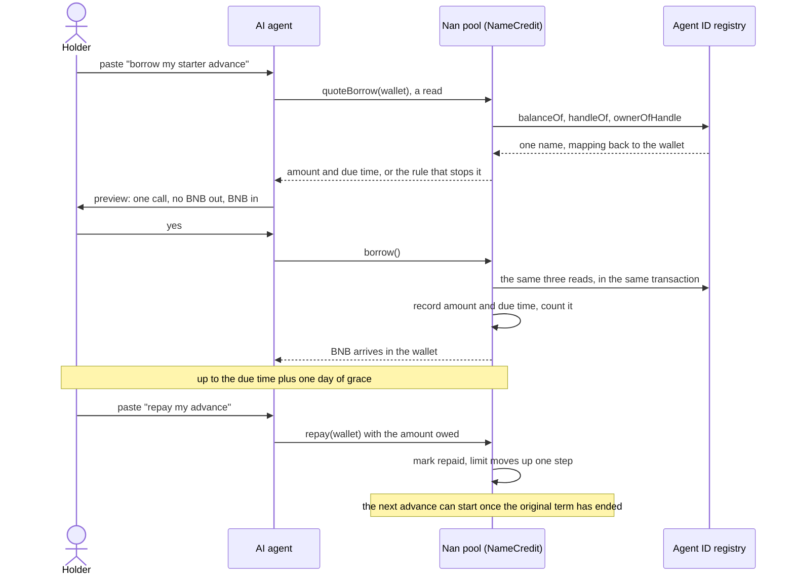
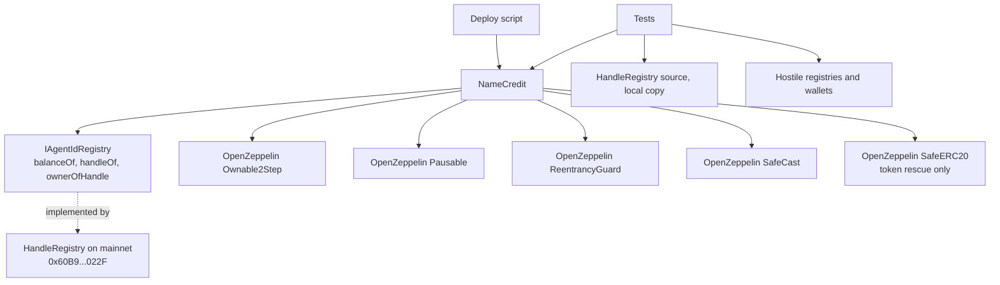

Nan is one contract, `NameCredit`, written in Solidity 0.8.28. It cannot be upgraded and has no proxy. The source is [`packages/contracts/src/NameCredit.sol`](https://github.com/ramakrishnanhulk20/nan/blob/main/packages/contracts/src/NameCredit.sol).

## BNB Smart Chain mainnet (chain 56)

| | Address |
|---|---|
| Pool, `NameCredit` | [`0xc0337932e0Cd049aFa990A9A470c059586B2d9AE`](https://bscscan.com/address/0xc0337932e0Cd049aFa990A9A470c059586B2d9AE), [verified source on Sourcify](https://repo.sourcify.dev/56/0xc0337932e0Cd049aFa990A9A470c059586B2d9AE) |
| Agent ID registry it reads (SPACE ID's `HandleRegistry`, not ours) | [`0x60B9262456dE011F7d15a54CdD8c48bAaa8B022F`](https://bscscan.com/address/0x60B9262456dE011F7d15a54CdD8c48bAaa8B022F) |
| Owner | [`0x96E854aBDdc5C618ca843956d1303017b586aB75`](https://bscscan.com/address/0x96E854aBDdc5C618ca843956d1303017b586aB75) |
| Website | [nan-agent.vercel.app](https://nan-agent.vercel.app), reading this pool live |
| Deployed | Block [135,449,026](https://bscscan.com/block/135449026), 24 November 2026 at 10:44:21 UTC, in transaction [`0xa0fac202...f1521991`](https://bscscan.com/tx/0xa0fac2024a5ad85829e7e49e16379802279389c0a54089f5e571ce3ff1521991) |

The source is verified on Sourcify with an exact match. The code at this address is byte for byte the code attacked on testnet, apart from the registry address it reads ([the record](https://github.com/ramakrishnanhulk20/nan/blob/main/security/outputs/mainnet-2026-11-24.txt)).

Settings in force:

| Setting | Value |
|---|---|
| First advance | 0.0003 BNB |
| Cap, the largest any advance can be | 0.0048 BNB |
| Term | 3 days, plus 1 day of grace that still counts as on time |
| Release pace | 100 first advances a day |

Settings changes applied since deployment: none. Nothing was scheduled when this was checked, on 25 November 2026 at block 135,655,406.

## BNB Smart Chain testnet (chain 97)

| | Address |
|---|---|
| Pool, `NameCredit` | [`0x31bed8A1f6C762ADF1F7208aFEaee828B1bF7726`](https://testnet.bscscan.com/address/0x31bed8A1f6C762ADF1F7208aFEaee828B1bF7726), [verified source](https://repo.sourcify.dev/97/0x31bed8A1f6C762ADF1F7208aFEaee828B1bF7726) |
| Stand-in Agent ID registry, deployed from the real registry's verified source | [`0x0921b8D3d052515612DAc3F0013F9bb51a86B0c6`](https://testnet.bscscan.com/address/0x0921b8D3d052515612DAc3F0013F9bb51a86B0c6), [verified source](https://repo.sourcify.dev/97/0x0921b8D3d052515612DAc3F0013F9bb51a86B0c6) |
| Attack runner | [`0x21F2277F1b0aA3430dBD7f5e1236d9F2529fBD14`](https://testnet.bscscan.com/address/0x21F2277F1b0aA3430dBD7f5e1236d9F2529fBD14), [verified source](https://repo.sourcify.dev/97/0x21F2277F1b0aA3430dBD7f5e1236d9F2529fBD14) |

Agent ID exists on mainnet only, so the testnet pool reads a stand-in registry owned by a testnet-only wallet, which issues the test names. The testnet pool runs with a 1 hour term so that the attacks can reach a late payment in a day. Every attack made against it is listed in [`security/outputs/testnet-2026-11-24.txt`](https://github.com/ramakrishnanhulk20/nan/blob/main/security/outputs/testnet-2026-11-24.txt).

## Check it yourself, with no key

These need only Foundry's `cast`. No key, no wallet and no BNB. Amounts are in wei (1 BNB is 10^18 wei) and times are in seconds.

The registry, the owner and the four settings:

```bash
cast call 0xc0337932e0Cd049aFa990A9A470c059586B2d9AE "REGISTRY()(address)" --rpc-url https://bsc-rpc.publicnode.com
cast call 0xc0337932e0Cd049aFa990A9A470c059586B2d9AE "owner()(address)" --rpc-url https://bsc-rpc.publicnode.com
cast call 0xc0337932e0Cd049aFa990A9A470c059586B2d9AE "settings()(uint96,uint96,uint32,uint32)" --rpc-url https://bsc-rpc.publicnode.com
```

Their output on 25 November 2026:

```text
0x60B9262456dE011F7d15a54CdD8c48bAaa8B022F
0x96E854aBDdc5C618ca843956d1303017b586aB75
300000000000000 [3e14]
4800000000000000 [4.8e15]
259200 [2.592e5]
100
```

The pool's totals:

```bash
cast call 0xc0337932e0Cd049aFa990A9A470c059586B2d9AE "totals()((uint64,uint128,uint128,uint128,uint128,uint128))" --rpc-url https://bsc-rpc.publicnode.com
```

On 25 November 2026, after the first borrow and repay, it read:

```text
(1, 300000000000000 [3e14], 300000000000000 [3e14], 0, 5000000000000000 [5e15], 0)
```

In order: people who have borrowed, BNB lent, repaid, outstanding, topped up and withdrawn. The numbers grow as people borrow.

One borrower's standing, for the team's own Agent ID wallet, ramm.ai:

```bash
cast call 0xc0337932e0Cd049aFa990A9A470c059586B2d9AE "standingOf(address)((bytes32,uint8,uint256,uint256,uint256,uint256,bool,uint256,uint16,uint16))" 0xC75126992E4744a75665405e9b427710C0d23052 --rpc-url https://bsc-rpc.publicnode.com
```

On 25 November 2026 it read:

```text
(0xb8b839662ac387011c3922c73794a36859cc001f8c1a0359555d2c8144e3e339, 1, 600000000000000 [6e14], 0, 0, 0, false, 1795867201 [1.795e9], 1, 0)
```

In order: the hash of its name, its step, its limit, what it owes, when that is due, when it turns late, whether it was marked missed, the earliest time it may borrow again (1795867201 is 28 November 2026 at 12:00:01 UTC), and its counts of on-time and late repayments.

From `packages/contracts`, `forge script script/Check.s.sol --rpc-url <a public node>` reads the same facts for a deployment and sends nothing. On mainnet it fails unless the pool reads the real Agent ID registry.

## One advance, start to finish



## What the contract depends on



The overview of the whole system is on the [Overview](/docs) page.
