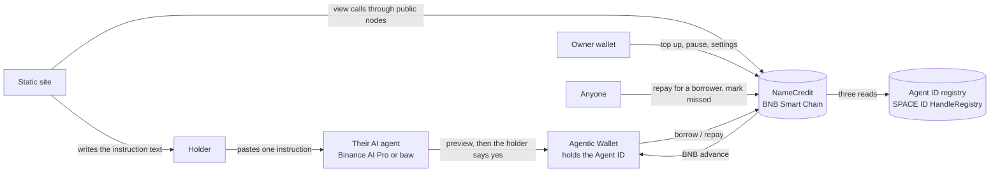

Nan is a lending pool on BNB Smart Chain. It lends a small advance in BNB to any wallet that holds a Binance Agent ID, with no collateral, no fee and no interest. Repay by the due time, plus one day of grace, and the next limit doubles, up to a cap.

## Borrow in three steps

1. On the [home page](/#borrow), type your Agentic Wallet address.
2. The page reads what the contract says about that wallet and writes a short text for your agent.
3. Paste the text into Binance AI Pro, read its preview, and confirm.

The page never asks for a signature, a QR scan or a seed phrase. The current amounts and times are on the home page, read live from the contract.

## How it fits together

## The contract

| Network | Address |
|---|---|
| BNB Smart Chain mainnet | [0xc0337932e0Cd049aFa990A9A470c059586B2d9AE](https://bscscan.com/address/0xc0337932e0Cd049aFa990A9A470c059586B2d9AE#code) |

The source is verified on BscScan and on Sourcify.
